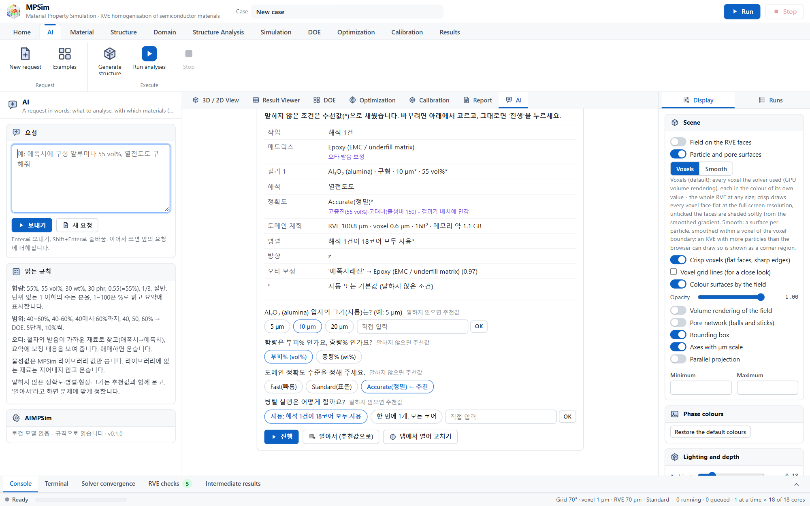

<p align="center">
  <picture>
    <source media="(prefers-color-scheme: dark)" srcset="docs/images/aimpsim_logo_dark.png">
    
  </picture>
</p>

<p align="center">
  
  <a href="https://github.com/HyoseokByun-opt/MPSim"></a>
  
  
  
  <a href="#verification"></a>
</p>

<p align="center">
  <b>AIMPSim</b> is <a href="https://github.com/HyoseokByun-opt/MPSim">MPSim</a> with an <b>AI</b> tab: type the case the
  way you would say it, and it becomes an MPSim run, a DOE study, a calibration or an optimisation - read by a local
  language model, checked against the sentence by rules, summarised before anything runs.
</p>

<p align="center">
  <a href="https://hyoseokbyun-opt.github.io/AIMPSim/">Website</a> ·
  <a href="#how-a-request-is-read">How it reads</a> ·
  <a href="#what-the-ai-tab-reads">What it reads</a> ·
  <a href="#the-local-model">The model</a> ·
  <a href="#verification">Verification</a> ·
  <a href="#installation">Installation</a> ·
  <a href="AIMPSim/docs/GUIDE_KO.md">Guide (Korean)</a>
</p>

<p align="center">
  
</p>

> 에폭시에 알루미나 55%, 아니 60%로 해줘. 열이 얼마나 잘 빠지는지 봐줘<br>
> epoxy with alumina, 55%, actually make that 60%, thermal conductivity<br>
> 알루미나랑 질화붕소 중에 에폭시에 30% 넣었을 때 어느 쪽이 열전도도 더 높은지 비교해줘

Before anything runs, the tab shows what was read from the sentence, what was calculated or corrected, where the
model and the rules read differently, which settings were chosen for the problem and why, and the RVE MPSim plans
for it. **Run** starts it; **Open in the tabs to edit** puts the case into MPSim's tabs instead. Everything runs on the
PC itself, offline.

## Two editions

| | MPSim | AIMPSim |
|---|---|---|
| Analyses, solvers, checks, guides | the same | the same |
| AI tab (requests in words) | - | yes |
| Local language model | - | included (Qwen3.5-2B, Apache 2.0; llama.cpp, MIT) |
| Repository | HyoseokByun-opt/MPSim | HyoseokByun-opt/AIMPSim |

Every change of MPSim is published to both repositories, so AIMPSim always carries the latest MPSim. The reading
engine lives in the folder `AIMPSim/`; everything else is MPSim. Install and start AIMPSim exactly as MPSim
(`1_INSTALL.bat` or the offline package, then `2_RUN_LOCAL.bat`); the user guide of MPSim applies unchanged, and
[AIMPSim/docs/GUIDE_KO.md](AIMPSim/docs/GUIDE_KO.md) describes the AI tab.

## How a request is read

1. **The model reads it.** Every message, a follow-up with the request so far, goes to the local model, which
   answers in a fixed JSON form (materials, contents or amounts, shapes and sizes, material values given, analyses,
   the task, DOE ranges, measurements, settings). It understands what rules cannot: a correction ("55%, no, 60%"),
   a word taken back ("not alumina", "skip the thermal part"), a property described instead of named ("how well
   heat gets out", "will it flow"), a purpose ("for a TIM", "a 5G substrate").
2. **The rules check it.** A material must be named in the sentence (as written, by spelling or by sound); a number
   must be in the sentence or follow from its numbers by a calculation that is shown (4:6 -> 60 %, 150 g in 100 g
   -> 60 wt%, 500 nm -> 0.5 um, a quarter -> 25 %); a material value must be the user's own; an analysis needs a
   word that points to it. Whatever fails is dropped and asked for.
3. **The rules fill in.** What the rules read exactly and the model left out comes back, unless the sentence takes
   something back. A size the rules read with its unit stands.
4. **The summary shows it.** Where the model and the rules read differently, the model's reading is used and the
   difference is listed; calculations, dropped values and material values given are listed too.
5. **The questions follow** as before: what only the user can give, with recommended answers for the rest.

Without the model (no model in `AIMPSim/llm/`, or `{"llm": "off"}` in `aimpsim_config.json`) the rules read requests
alone, as in 0.1.

## What the AI tab reads

| Item | Examples | Rule |
|---|---|---|
| Matrix | 에폭시, 실리콘 수지, PI, BT 레진, epoxy, silicone | a resin word after it, or the polymer of the library; else the material without a content ("알루미늄에 SiC 50%") |
| Fillers | 구형 알루미나, 판상 BN, 은 플레이크, glass fibre | every material of the MPSim library (68), by Korean and English names, formulae and common abbreviations |
| Content | 55%, 55 vol%, 55 부피%, 30 wt%, 30 중량%, 30 phr, 0.55, 0.55만큼, 오십오 퍼센트, 영점오오, 1/3, 삼분의 일, 절반, fifty five percent | see below |
| Size | 5um, 5 µm, 5 마이크로, 5미크론, 오 마이크로, 500 nm, 입경 5, D50 5 | a number after a size word without a unit is taken in µm, and the summary says so |
| Shape | 구형, 판상, 플레이크, 섬유, 불규칙, 파쇄, 큐브; spherical, flake, fibre, irregular | platelets as oblate spheroids (aspect 0.2, or 1/AR), fibres as cylinders (10 diameters, or AR), irregular grains as random polyhedra |
| Analyses | 열전도도, 전기전도도, 유전율, Dk/Df, CTE, 탄성계수, 점도, 흡습, EMI 차폐, 투자율, 휨, 줄 발열, ... | all 21 MPSim analyses; "전도도" alone is asked (thermal or electrical) |
| Task | 40~60%, 40, 50, 60%, 40/50/60%, 5단계, 10%씩 → DOE; measurements + 보정 → calibration; 최대/최소 + a range → optimisation; 구조만 → structure only | |
| Settings | 빠르게 / 표준 / 정확하게; 코어 8개, 동시에 2개, 3번 반복, seed 5, 3방향, RVE 40um, 복셀 0.5um | |
| Follow-ups | "55%", "구형이고 5마이크로", "알루미나 말고 질화붕소로", "CTE도 추가", "CTE는 빼줘", "함량은 40%로", "boron nitride instead of alumina" | a further message changes the request before it |
| Casual wording | "에폭시에 알루미나 반 정도 섞으면 열이 얼마나 잘 빠질까?", "열전도도는 필요없고 CTE만", "epoxy with alumina, 55%, actually make that 60%", "에폭시에알루미나55%넣고열전도도" | read by the model, checked by the rules |
| Amounts | "수지 100g에 알루미나 150g", "100 parts epoxy, 150 parts alumina", "4대6" | the weight or volume percent, the calculation shown |
| Material values | "k가 25 W/mK인 알루미나", "epoxy (k 0.2, E 3 GPa)", "실리카 유전율은 3.8로", "알루미나 k를 라이브러리보다 10 낮게", "BN 열전도도 30% 높게", "절반으로" | the user's value (or the library's changed as said) in this request's case only, both shown; the library is not changed |
| Design | "에폭시 필름에서 알루미나를 가장 적게 넣고 z방향 열전도도 3 W/mK가 되는 크기와 배합비율", "the least filler for k 5 W/mK, sizes 1-30 um, max 70 vol%" | a DOE over what is to be found, then the recipe (see Design requests) |
| Interface resistances | "필러-레진, 필러-필러간 열저항은 1E-8", "interface resistance 2e-8", "1.5x10^-8 m2K/W" | R_int and R_c on every filler |
| Comparisons | "알루미나랑 질화붕소 중 어느 쪽이 ...", "alumina vs boron nitride" | each on its own (separate runs), never one mixture; asked first |

**Contents.** A number with a percent sign or word (%, 퍼센트, 프로, percent) is a percent. A number of 1 or less
without a unit is a fraction (0.55 → 55 %); a number above 1 and up to 100 without a unit, said of a material, is a
percent. a/b is a fraction when b is 12 or less (1/3, 3/4); otherwise it is a list of levels (30/40/50). The basis is
the unit's (vol%, wt%, 부피%, 중량%, v/v, w/w) or a basis word in the sentence (부피비, 중량 기준, by weight, volume
fraction); phr is converted to wt% with the resin's 100 parts. When the matrix is given ("에폭시 40%에 실리카"), a
single filler takes the rest. A number belongs to the material of its clause ("에폭시 수지 45%와 알루미나 55%",
"epoxy with 30 vol% silica", "55 vol%의 알루미나", "(플레이크, 10 마이크로)"). A content outside 0-100 % is asked again;
fillers adding up to 100 % or more are refused.

**Typing errors.** A word that names nothing exactly is compared with every name by spelling and by sound: Korean
in jamo, vowels that sound alike (ㅐ/ㅔ) and tense or aspirated consonants (ㄲ/ㅋ/ㄱ) as one, final consonants as
they sound; English with ph = f, c = s/k and doubled letters once; and a key shared by both scripts lets 실리카
find silica. At 0.8 or more the closest name is taken and shown in the summary ("'애폭시레진' → Epoxy (0.97)"); a tie
of sounds is decided by the spelling; from 0.65 it is offered as a question. Short words need 0.9, and common words
are never matched. A known name inside an unknown word ("그래핀옥사이드" holds 그래핀) is asked about, not taken.

**Nothing is made up.** Material values are the MPSim library's, or a value the user gives in the request. A
material the library does not hold is asked about (or added in the Material tab); it is never invented. A number is
used only where the sentence says it, or follows from its numbers by a calculation the summary shows.

## What it asks, and what it decides

Asked always, even with "decide for me": the matrix, every filler and its content, the property to compute, the
range of a DOE and the measurements of a calibration. Asked with a recommended answer (pre-selected) when not said:
the content basis (vol%), the particle shape (sphere) and size (10 µm), the accuracy level and the parallel runs.
"알아서", "자동으로", "기본값으로", "decide for me" or the button **Decide for me** takes the recommendations, which
follow the problem:

- **Accuracy level** - Accurate when the loading is dense (45 vol% or more) and the property contrast high (30 or
  more), where MPSim's own study found the result most sensitive to the arrangement; Standard otherwise (within 1 %
  for moderate loadings); for a DOE, Standard from 10 cases and Fast from 30, so that it finishes.
- **Parallel runs** - one run takes every core; a study runs several cases side by side (about six cores each),
  MPSim checking the memory.
- **Directions** - z, or x, y and z when particles are aligned.
- **Shape and size** - spheres of 10 µm (MPSim's default); conduction without an interface resistance does not depend
  on the absolute size.

The summary marks every value that was not said with `*`.

## Material values for one request

A value given in the request - absolute ("알루미나 열전도도는 20 W/mK로", "use k = 20 for the alumina"), relative to
the library ("라이브러리보다 10 낮게", "30% 높게", "절반으로", "doubled") - is written into the phase (or matrix) of
the case MPSim runs, and the phase name carries it ("Al₂O₃ (alumina) · k 20"). The material library is not
changed: the next request starts from the library values again, while a follow-up in the same conversation keeps
the value. A value is a material's only when the material is named beside its property; the composite's target
("열전도도를 3 W/mK로 할 수 있는") is not one.

## Design requests

A request that names a target and asks what to use to reach it is a design: "10 µm 에폭시 필름에서 알루미나 함량을
가장 낮게 하면서 z방향 열전도도 3 W/mK가 되는 크기와 배합비율, topcut 3 µm, 가장 작은 입자 200 nm, 최대 62 vol%,
분포는 고려하지 않음, 필러-레진·필러-필러 열저항 1E-8, 비슷하면 점도는 낮고 패킹은 잘되는 조합".

- **Read.** The rules read the explicit parts: the target with its unit, direction and sense (≥ to reach, ≤ for
  "이하"), what is minimised, the bounds of size (topcut, smallest particle) and content, one size per class, the
  interface resistances, the film, what is to be found (content, size, blend) and the preferences (low viscosity,
  good packing). The model fills only what they leave open. The design's numbers are nobody's content, size or
  material value: 100 − 62 = 38 % is not the filler's content and the target k is not alumina's.
- **Planned.** Two sizes of one material when a blend is asked (coarse and fine, the split at the geometric mean of
  the bounds), or the two materials named. The DOE varies the total content (from 22 vol% below the maximum, or the
  bounds said), the fine share of the filler (0-50 %) and each size (log-spaced): a Latin hypercube of 10 cases per
  factor (40 for four), a full factorial for one or two. The fixed conditions (film, R_int, R_c, direction, mono
  sizes) are in its base case.
- **Grid.** Sizes that vary get each case its own grid (MPSim's DOE grid "Own"): the RVE edge and the voxel planned
  by MPSim for that case's particles at the accuracy level (the smallest particle at 6 voxels per diameter at Fast).
  This holds for every study that varies a size, design or not; a grid the request sets stays as set. The summary
  shows the plan of the base case and of the heaviest corner of the ranges (the finest particles beside the
  coarsest, at the most filler).
- **Chosen, round by round.** When every case is done, a Gaussian-process surrogate of the target property (MPSim's
  optimise.py, cross-validated; the realised content of each run, not the asked one) gives, for 1,500 combinations
  of sizes and share, the lowest content that meets the target with its prediction one standard deviation on the
  safe side. Of the recipes within 1 vol% of the lowest content, the one of lowest viscosity is recommended when the
  request prefers low viscosity or good packing. Packing and viscosity are not fitted: φm is the random close
  packing of the blend (Farr-Groot) and the relative viscosity Krieger-Dougherty with it, the closed forms MPSim's
  viscosity analysis uses for spheres, evaluated at every candidate. A surrogate that cross-validates weakly
  (R² below 0.7) does not choose: the run that met the target with the least filler is recommended.
- **Run until it answers.** After every round the surrogate is judged where the decision is made: the standard
  deviation of its prediction at the recipe, over the slope of the property with the content, is how sure the
  recipe's content is (in vol%).
  - **Not sure enough** (more than the 1 vol% tolerance, or R² below 0.8). The points that settle the decision are
    added to the study and run: the recipe first, then where the surrogate is least sure whether the target is met
    (1.96 σ − |μ − target|, Bryan et al. 2005), near the lowest content, spread apart. MPSim adds them to the same
    study (its DOE tab shows them).
  - **Sure enough.** The recipe is run with three realisations of its structure (the target property and the full
    viscosity analysis, with particle dynamics). A check that meets the target ends the design. One that does not
    joins the data at the content its structures really hold, the surrogate is fitted again and the next recipe
    comes from that fit, so a recipe that fell short is never checked twice.
  - **The error no longer falls from one round to the next** (by less than 10 %). What is left is the scatter of a
    single run, not the lack of points: the recipe is decided by its check run, and the answer says so.
  - **The surrogate is sound and the target out of reach in the ranges.** The design stops with the best that can be
    reached.

  Each round is reported in the conversation: the runs, the R², how sure the content is and what is done next.
- **A few slow runs do not hold a round up.** Once nothing of the study is queued and at most a tenth of its runs
  (two at least) are still going, for half as long again as the study took to get there (ten minutes at least), the
  round goes on with the finished runs; the slow ones keep running and join the next round.
- **Talk to it while it runs.** "멈춰" or "stop" stops it at once (the study's runs and the check run with it). "최대
  함량은 55%로" or "1% 이내면 같은 걸로" applies from the next round. A safety limit of 12 rounds
  (`"max_rounds"` in `aimpsim_config.json`, 0 = none) only stops a loop that has not ended on its criteria.

- **Other designs read the same way**, each planned into its own study:
  - **Several targets.** "유전율 3.0 이하이면서 CTE 30 ppm/K 이하": every target's analysis runs in every case, each
    property gets its own surrogate, and the recipe meets all of them; the one that sets its content (the binding
    target) is the one each round judges. A check run must meet every target.
  - **Three sizes said one by one.** "알루미나 70um, 5um, 0.5um 세 가지 크기 섞어서": the sizes stay as said; the study
    varies the total content, the medium share and the fine share of the filler (MPSim's `mix.1` and `mix.2`).
  - **A range for each class.** "대입자 20~70um과 소입자 0.5~5um", "대입자 topcut 80um, 소입자 최소 1um": each size
    varies within its own class's range.
  - **A range of sizes of one filler** ("BN 크기는 5~30um 중에서", "BN은 2~10um") is a size to find within it.
  - **A content range** ("총 함량 60~70vol%") is varied; **the lowest viscosity** may be the goal instead of the least
    filler; **a value to meet** ("1.5 W/mK 정도", "2.5 W/mK에 가장 가까운") is a target of equality; **wt%** ("최소
    wt%", "최대 90wt%") keeps the study by weight.
  - **Electrical conductivity** spans decades across percolation: it is fitted as its logarithm, held within four
    decades of the target, so the step below percolation does not wreck the fit.
- **Words read for designs** include "최소 몇 %", "몇 % 넣어야 해", "the lowest total vol%", "as little boron nitride as
  possible", a target said without its unit after its property ("열전도 3 넘기려면": 3 W/m·K, noted), "둘 다 구형
  20um" (both fillers), "은 플레이크" (a flake), "언더필 레진", "실리콘 TIM 패드", "갭필러" (the resin, not a filler),
  and a bound after another bound word ("최소 함량, 최대 60vol%": 60 is the maximum).

Reductions, stated: viscosity and packing are not solved in each DOE case; the DOE runs at the accuracy level its
size calls for (Fast from 30 cases); up to three sizes of one material (when all three are said), two classes with a
range each, or two materials. Sizes far apart (a ratio above about 20) need large grids: the summary shows the
memory of the heaviest corner.

## Optimisation run until it stands

A request for the best value over ranges ("함량 30~55%, 크기 5~30um로 바꿔가며 열전도도 최대"), or for a value to
be met, runs its DOE, then round by round:
- **The surrogate's accuracy first.** It is cross-validated every round. While R² is below 0.8, half of the next
  points go where the surrogate is least sure (largest σ), to make it sound, and half where improvement is expected.
- **Then the expected improvement** over the best run (Jones, Schonlau and Welch 1998). The points of highest
  expected improvement, spread apart, are added to the same study and run, until it falls below 1 % of the range the
  runs span (or the best run has not improved over two rounds). Once the runs fill the space at the spacing the
  points keep (one factor: after about nine runs), the spacing halves so the search can close in.
- **The optimum is run before it stands.** The predicted optimum is added to the study as one more case. It stands
  when that run gives what was predicted (within 2 σ) and the fit that now holds it keeps the optimum there. Then the
  answer gives the conditions and the measured value. Otherwise the run is part of the data and the search goes on.
  An optimum that is a run already is its own check. Two checks that do not settle it are the scatter of a single
  run, and the best run is the answer, which the reply says. A check that agrees with its prediction does not stand
  when a run already made is better by more than three times the runs' scatter about the fit (the fit smoothed a
  corner or a peak): that run is the answer.
- **Improvement is measured against the better half of the runs** (the range they span), so that the decades of an
  electrical conductivity below percolation do not make every improvement at the top look small. An electrical
  conductivity is searched as its logarithm, held within four decades of the best run.
- **A factor that does not matter is said so.** Across its whole range at the optimum, a factor may move the
  prediction by less than twice the runs' scatter (the cross-validated RMSE). Then the answer says it does not set
  the optimum, rather than giving the best of the scatter as the best value. Example: alumina of 5-30 µm with no
  interfacial resistance conducts alike, since the size changes only the scale. On 25 real runs (Fast, each case
  its own grid) the size moved the prediction by 0.01 W/m·K against an RMSE of 0.18 W/m·K, R² 0.982. The answer:
  55 vol%, the size free.
- Then MPSim's Optimization tab opens on the final study.

On synthetic data with 3 % run-to-run scatter (the loop tests): a monotonic rise ends at the corner run after one
round; a peak inside the range ends in round four, its check within the prediction, 0.7 vol% from the true peak;
a value to be met (1 W/m·K) ends at 0.993 W/m·K true.

## Calibrations the AI checks

- **Before the run.** The measurements are set against the parallel and series bounds of filler and matrix with the
  library values (Wiener bounds, which hold for any microstructure). Then each set of unknowns - what the request
  asked for, the filler's conductivity, the matrix's, both, the filler's with R_int - is tried on MPSim's own
  effective-medium preview (calibrate.preview, under a second each). When what was asked cannot reach the data, the
  set that can is pre-selected with the reason, and the request's own stays a choice. Example: "에폭시에 실리카
  20%일 때 0.45 W/mK, 40%일 때 0.8 W/mK 측정됐어. 계면저항 보정해줘" - 0.8 W/mK at 40 vol% lies above the parallel
  bound with fused silica (0.67), so no interfacial resistance reaches it (the RVE gave 0.294 and 0.428 at the lowest
  R_int); the filler and matrix conductivities reach it (RVE calibration: silica 6.39, epoxy 0.259 W/m·K, both
  measurements within 0.3 %), and the reply notes that 6.39 is close to the library's crystalline silica (6.5).
- **Until it reaches the data.** A result that does not reach the data is read. The effective-medium model is
  corrected by what the RVE gave at the estimate, and the next calibration is chosen. There is no fixed number of
  rounds:
  - a range is widened (a hundredfold at the end the estimate sat on) for as long as the estimate sits at its end,
    up to the physical limits of the quantity;
  - every other set of unknowns is tried once;
  - so the candidates run out.
- **When nothing is left to change, the person is asked**, with what only they can decide: another grade of the
  filler from the library (crystalline silica instead of fused silica, say), the other content basis (wt% instead of
  vol%), or to stop. The answer - a click, or words such as "결정질 실리카로", "wt%로" - changes the case, which is
  checked again and calibrated. "멈춰" stops it at once.
- **Other properties.** Thermal conductivity is checked on the effective-medium model. For a CTE, a permittivity, a
  modulus or an electrical conductivity the material value that property depends on is fitted: the one the request
  names ("실리카 CTE 보정": the silica's CTE; "BN 열전도도 보정": the BN's conductivity; "에폭시 열전도도와 계면저항 둘
  다": both), otherwise the resin's own value (CTE, permittivity, modulus) or the particles' conductivity (electrical).
  MPSim's interface and contact resistances act on the heat flow only, so a resistance asked for with other data is
  replaced, and the summary says why. A range the estimate sat at the end of is widened up to the physical limits,
  then each other set of unknowns of that property is run once, then the person is asked.
- **Measurements as people write them.** "40, 50, 60vol%에서 각각 0.9, 1.4, 2.3 W/mK", "30 vol% and 50 vol% ...: 0.62
  and 1.35 W/mK", "0.45 and 0.92 W/mK for ... 20 and 40 vol%", "유전율: 20vol% 3.0, 40vol% 3.4": one measurement
  each, at its own content, in order. A material value equal to a measurement ("BN k = 1.1" from "20wt%일 때 1.1
  W/mK") is the measurement, not the material's. A conductivity measured in-plane ("면내 열전도도") is fitted along
  x, otherwise through the thickness.
- R_c follows R_int (R_c = 2·R_int) on touching particles, as MPSim recommends, unless R_c is calibrated itself.

## The local model

Qwen3.5-2B (1.2 GB, 4-bit Q4_K_M, Apache 2.0, the Qwen team) and llama.cpp's server (`llama-server`, build b11606, MIT) are
in `AIMPSim/llm/` of the offline package; `AIMPSim\GET_AI_MODEL.bat` downloads both for an installation from the
source and checks their SHA-256. AIMPSim finds them without any setting.

- It starts when the AI tab is opened and reads its instructions once (under a minute); a request then takes
  3-4 s on a laptop CPU (Intel Core Ultra 5 125H). It uses 4 threads, so that the solvers keep their
  cores, and about 2 GB of memory. It listens on 127.0.0.1 only, on a free port, and ends with MPSim.
- `AIMPSim/aimpsim_config.json` overrides it (see `aimpsim_config.example.json`): another GGUF model, a server
  already running (`url`), or `{"llm": "off"}` for the rules alone.
- Its answer is held to a JSON schema by the server, and checked as described above before anything of it is used.

**Why this model.** Four small models with an open licence were read through the same checks on the 50 held-out
requests (none of them used to tune anything before), on the same laptop CPU, with the same checks (those of
the comparison; the release's checks, written after it, read more of them - see Verification):

| Model (4-bit GGUF) | File | Right | Asked | Wrong | Per request |
|---|---|---|---|---|---|
| **Qwen3.5-2B** (Apache 2.0) | 1.2 GB | 38 | 9 | 3 | 2.7 s |
| Qwen3.5-4B (Apache 2.0) | 2.6 GB | 42 | 7 | 1 | 6.9 s |
| Gemma 4 E2B (Apache 2.0) | 2.6 GB | 37 | 9 | 4 | 7.8 s |
| Granite 4.2 3B (Apache 2.0) | 2.1 GB | 37 | 9 | 4 | 14.2 s |

The larger Qwen reads a little more without a question, at two and a half times the time and twice the size (more
than GitHub's 2 GiB per release file); the checks keep the smaller one from reading wrongly. It can be chosen
instead: `AIMPSim\GET_AI_MODEL.bat --model qwen3.5-4b` (`--list` shows the others).

## Verification

The AI tab is checked on the inputs it makes, not on the analyses (those are MPSim's, checked by its own self-test,
`5_SELF_TEST.bat`, 90 problems with known solutions). Every request below has its answer written down; a reading is
right, asked (left open and asked - safe), or wrong (read as something else).

**Requests as people write them** (`python AIMPSim/tests/freeform.py`, with `--llm <llama-server> <model>` for the
model): roundabout wording, corrections, words taken back, spacing, Korean and English mixed, typing errors, amounts,
material values, sizes, settings, studies, calibrations, vague amounts and requests that are not requests.

| Set | Rules alone | Qwen3.5-2B + checks |
|---|---|---|
| 114 requests the checks were developed on | 55 / 29 / 30 | 110 / 4 / 0 |
| 50 held out, then used for changes | 28 / 11 / 11 | 47 / 3 / 0 |
| 40 held out, then used for changes | 21 / 8 / 11 | 39 / 1 / 0 |
| 30 written last, then used for changes | 16 / 4 / 10 | 30 / 0 / 0 |

(right / asked / wrong). The first reading of these sets with the 0.3.0 changes gave 102 / 11 / 1, 40 / 8 / 2,
38 / 2 / 0 and 22 / 4 / 4: two worked design requests in the model's instructions made it copy their numbers and read
silica as SiC in ordinary requests. They were removed (the rules read design requests on their own) and the
misreadings found were fixed, so every set above is now one that changes came from. The 30 written last, read before
any change came from them (0.2.0): Qwen3.5-2B 25 / 3 / 2, Qwen3.5-4B 27 / 3 / 0, the rules alone 14 / 6 / 10.
Reading with the model takes 3-4 s per request (median).

**Requests written to rule** (they must not get worse with the model):
- `python AIMPSim/tests/run_tests.py` - 118 hand-written requests, 98 inputs validated by MPSim, conversations of
  several messages (rules alone and model-first through a stand-in server), the checks on made-up model answers
  (invented materials, numbers and material values, broken answers, no answer), and since 0.3.0:
  - design requests in five phrasings, Korean and English, each planned into a DOE whose every case MPSim accepts,
    and the recipe chosen from a stand-in study;
  - material values for one request in six forms, never kept in the library;
  - the calibration checks: the precheck on data an interfacial resistance cannot reach and on data it can, and the
    next round after a result that did not reach the data.

  Rules alone: 118/118 and every added test passed. Read through Qwen3.5-2B: 118/118 (98/98 inputs accepted by
  MPSim), every added test passed. Through Qwen3.5-4B (0.2.0): 118/118.
- `python AIMPSim/tests/exhaustive.py` - generated requests, each with its answer: every alias of every material,
  every way of writing a content, size, shape, analysis, DOE, calibration, optimisation goal and setting, pairs of
  fillers, Korean word orders and particles, typing errors made from every alias, and random combinations. Rules
  alone, 5,026 requests: no input wrong, nothing missed, 140 asked. A sample of 20 per kind read through Qwen3.5-2B
  (309 requests): 280 right, 29 asked (by design: sentences that are not requests and unknown names), none wrong,
  none missed.

**Design, optimisation and calibration requests** (`python AIMPSim/tests/studies.py`, `--holdout`, `--loops`, `--llm`):
requests of the kinds above beside the first one a user wrote - one target or two, one size, two or three, a range per
class, two materials, platelets, fibres, films, wt%, electrical, CTE, permittivity and modulus targets, values to
meet, the lowest viscosity, optima of one and two factors, calibrations of every property with measurements written
in lists - each with its reading, its plan (DOE parameters, ranges, cases, grid) and its calibration unknowns written
down.

| Set | Rules alone | Qwen3.5-2B + checks |
|---|---|---|
| 37 requests the changes came from | 37 / 0 / 0 | 37 / 0 / 0 |
| 20 written after those changes (first reading) | 12 / 1 / 7 | 19 / 0 / 1 |
| the same 20, after the changes they led to | 20 / 0 / 0 | 20 / 0 / 0 |

With `--loops` every design and optimisation request is planned and its loop followed to the end on a stand-in
solver (closed forms of each property: differential Bruggeman with interfacial resistance, Maxwell Garnett, Turner,
Mori-Tanaka, a percolation power law) with 3 % run-to-run scatter. A target the stand-in cannot reach in the ranges
must end "out of reach", and the same study with a target it can reach must end with a checked recipe that holds on
the stand-in; an optimum must be within 8 % of the range of the best point of a grid. The 37 requests hold 31 studies (6 optimisations), the 20 later ones 15 (4): every loop ended as it must. Ten targets were beyond the stand-in in their ranges and stopped as out of reach; given a target it could reach, the same ten studies ended with a checked recipe that holds on it. Nine designs first extended their content range downwards (a ceiling on CTE or permittivity met with little filler).

**Run end to end** (MPSim 5.6.4, in a browser, MPSim's own runs at Fast, the bundled model, no browser errors):

| Request | What the loop did | Answer |
|---|---|---|
| PPE + silica 5 µm, ε_r ≤ 3.0 and CTE ≤ 40 ppm/K, least silica, ≤ 60 vol% | 9 cases (38-60 vol%); the recipe sat at the low end three times, the range was extended down to 18 vol%; check | 18.71 vol%: ε_r 2.753, CTE 39.77 (three realisations), 317 s |
| Silver 10 µm in epoxy, 10-40 vol%, highest σ | 5 cases, two rounds of 4 where the surrogate was weakest; the optimum is a run | 40 vol% (2.6 × 10⁵ S/m), 148 s |
| Silica CTE from 36 ppm/K at 40 vol% and 25 at 55 vol% | the estimate sat at the end of its range twice; widened to 100 | reached (34.1 and 25.8 by the RVE), 71 s; the reply notes that 16.7 ppm/K is 33 times the library's silica |
| Alumina 20, 10 and 5 µm in silicone, k ≥ 1.5 W/m·K, least filler | 30 cases (content, medium and fine shares), 6 points added (R² 0.79), a check that fell short joined the data | 46.75 vol%: 1.506 ± 0.018 W/m·K, 2,292 s |
| Alumina coarse 8-16 µm and fine 4-8 µm in epoxy, k ≥ 2 W/m·K | 40 cases, three rounds of 6 points until the content was sure to 0.93 vol%; check | 48.25 vol%: 2.137 ± 0.011 W/m·K, 395 s |
| Silica, 0.45 and 0.8 W/m·K, R_int kept as asked | R_int alone fell short; switched to the filler and matrix conductivities | reached: silica 6.9 (the library's crystalline silica 6.5), epoxy 0.248, 36 s |
| Silica, 3 and 5 W/m·K (out of reach) | asked; crystalline silica chosen by a click, calibrated, asked again; stopped by typing "멈춰" | stopped, 41 s |

The user's design request above, run the same way (40 cases at Fast, each its own grid), ends by itself in 17-22 minutes
with MPSim 5.6.5 (two runs): a case takes 48 s (median) and at most 10 minutes. With MPSim 5.6.4 the dense blends (54-60 vol% of
2.4-3 µm alumina with fines) crept for an hour or more in the packing and the run did not end within four hours; MPSim
5.6.5 packs spheres of different sizes largest first. After two rounds (46 cases, R² 0.974) the answer is that
3 W/m·K is out of reach within 62 vol% for 0.2-3 µm alumina with R_int = R_c = 1E-8 m²K/W: the best run gave
2.44 W/m·K, the surrogate's best 2.63 ± 0.07 W/m·K at 62 vol%. Six cases set to 59.6-61.8 vol% held 59.1-59.9 vol% -
nearly equal sizes, or 3 µm particles with few fines, pack no further in the 10 µm film without overlap - and the
answer says so instead of suggesting a higher content.

## Installation

**PC without internet.** Download `AIMPSim-0.3.1-offline-win64.zip` from the
[latest release](https://github.com/HyoseokByun-opt/AIMPSim/releases/latest): MPSim with the AI tab, the model and its
server, the Python runtime, every wheel and openEMS. Unzip to a short path such as `C:\AIMPSim`, run
`1_INSTALL_OFFLINE.bat`, then `2_RUN_LOCAL.bat`. For the larger model, unzip
`AIMPSim-0.3.1-model-qwen3.5-4b-part1of2.zip` and `...part2of2.zip` into the same folder; the AI tab uses it from then on.

**PC with internet and conda.**

```bat
git clone https://github.com/HyoseokByun-opt/AIMPSim.git C:\AIMPSim
cd C:\AIMPSim
1_INSTALL.bat
AIMPSim\GET_AI_MODEL.bat
2_RUN_LOCAL.bat
```

`GET_AI_MODEL.bat` downloads llama-server and Qwen3.5-2B and checks their SHA-256; `--model qwen3.5-4b` takes the larger
model, `--list` shows the others. MPSim's user guides apply unchanged
([English](https://github.com/HyoseokByun-opt/MPSim/releases/latest/download/MPSim-User-Guide-EN.pdf),
[Korean](https://github.com/HyoseokByun-opt/MPSim/releases/latest/download/MPSim-User-Guide-KO.pdf)); the AI tab is
described in [AIMPSim/docs/GUIDE_KO.md](AIMPSim/docs/GUIDE_KO.md).

## Related projects

- [MPSim](https://github.com/HyoseokByun-opt/MPSim) ([project page](https://hyoseokbyun-opt.github.io/MPSim/)) -
  the simulation program inside AIMPSim: effective properties of semiconductor materials from their 3D
  microstructure.
- [AICAD](https://github.com/HyoseokByun-opt/AICAD) ([project page](https://hyoseokbyun-opt.github.io/AICAD/)) -
  AI-assisted CAD modelling: engineering drawings or descriptions to parametric 3D solids (STEP) and beam and shell
  analysis models, with a local vision-language model and the OpenCASCADE kernel.

## Licence

MIT (see LICENSE). AIMPSim is MPSim with the AI tab; the open-source projects MPSim builds on are listed in its
[README](https://github.com/HyoseokByun-opt/MPSim#license). The local model is Qwen3.5-2B (or -4B) by the Qwen team,
Apache License 2.0 (its licence is in `AIMPSim/llm/models/`), run by llama.cpp (MIT, `AIMPSim/llm/bin/LICENSE-llama.cpp`).

**Declaration of AI assistance.** The code and the tests were written with the assistance of Claude (Anthropic;
Claude Code with Claude Opus 5.5), an AI assistant, working under the author's direction. The author reviewed the
output and takes full responsibility for the content; commits written with its help carry a `Co-Authored-By: Claude`
trailer.
